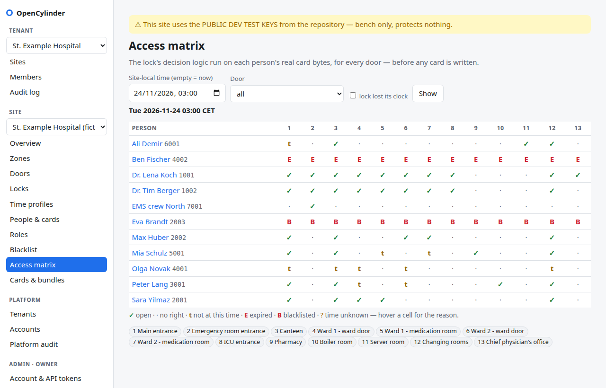

# OpenCylinder

Open source smart lock — hardware, firmware and software — for an electronic
Euro-profile cylinder that **you** own end to end: your cards, your keys, your
commissioning. Offline by default — no radio, no cloud, no vendor; online
components are optional additions ([`docs/online-architecture.md`](docs/online-architecture.md)).

> **Status: early development.** Nothing here is secure for a real door yet.
> See [Security status](#security-status).

## Try it — the manager GUI

```bash
python3 manager/app.py        # then open http://127.0.0.1:8243
```

On first start you choose a user and password and can load the fictional
example hospital. Then click through doors, people, cards and locks, and see
in the **access matrix** who opens which door at any time. It runs fully
offline. More screenshots and details are in [`manager/`](manager/README.md).



## Why

Commercial electronic cylinders open (at best) the *read* side — how a lock
reads a card — but never the *provisioning* side: injecting keys into the
lock's secure storage. That step stays locked to the vendor's tool, cards and
credentials. OpenCylinder owns that step: your own admin card, your own
management/encoder tool, your own site key
([`docs/commissioning.md`](docs/commissioning.md)).

## OpenCylinder vs. OSS Standard Offline

[OSS Standard Offline (OSS-SO)](https://www.oss-association.com/oss-standards/standard-offline-by-oss/)
is the established industry standard for offline, data-on-card access
control: it defines the card data layout so that locks of different brands
read and interpret the same card. It solves a different problem than
OpenCylinder — **interoperability between vendors** rather than **owning
the whole system** — so neither is better across the board.

| | OSS-SO | OpenCylinder |
|---|---|---|
| Specification | members-only (membership 650–5,000 €/year) or on request | public, MIT, in this repo ([`spec/`](spec/card-format.md)) |
| Key management | separate OSS key-management standard: operator-generated keys (per BSI-TL 03424), loaded via a key transport card; spec members-only | public; every step — key generation, card personalisation, lock commissioning — runs with open tools ([`docs/commissioning.md`](docs/commissioning.md)) |
| Lock commissioning / card tooling | vendor software | open tools in this repo; no membership, licence or vendor software |
| Multiple independent sites on one card | card data can be split into "sites" (details not public) | one DESFire application **per site** with its **own keys** — home, hospital, EMS station, workshop on one card, cryptographically separated; any admin can set up a site ([`spec/card-format.md`](spec/card-format.md#multiple-sites-on-one-card)) |
| Firmware | closed, vendor-specific | open source, auditable, reproducible builds |
| Recovery if the vendor disappears | depends on the vendor | nothing to depend on — escrowed keys + open tools |
| Multi-vendor interoperability | **yes — the main purpose** | no — OpenCylinder cards work with OpenCylinder locks only |
| Certified products | **yes** — certification programme (2026), commercial cylinders with EN-rated mechanics | no — DIY, uncertified |
| Maturity | deployed industry standard | early development |

**Where OpenCylinder is the better choice:** you want to own every layer —
read *and* provisioning side — audit the code, and never depend on a vendor
tool, licence or NDA. OSS-SO opens how a lock *reads* a card and is working
towards operator-held keys, but its specifications and tooling stay with
members and vendors. With OpenCylinder, every operator — a household, a
hospital, a volunteer EMS station — can run their **own** site with their
**own** keys, side by side on the same card, without asking anyone.

**Where OSS-SO is the better choice:** you need certified hardware, mixed
brands on one site, or a system an installer can support today.

*OSS-SO facts as published by the OSS Association on its
[OSS-SO](https://www.oss-association.com/oss-standards/standard-offline-by-oss/) and
[key management](https://www.oss-association.com/oss-standards/standard-key-management-by-oss/)
pages (checked 2026-11); the specifications themselves are not public, so
details beyond the public pages are not compared here.*

## How it works

```
 DESFire card ──► ST25R3916 NFC frontend ──► MCU
                                             │ desfire_auth: AES mutual auth
                                             │   (a cloned UID opens nothing)
                                             │ read access record (data-on-card)
                                             │ valid? this door? not blacklisted?
                                             ▼
                                   motor + worm → dog clutch → outer knob drives cam
```

- **Cards:** MIFARE DESFire with an OpenCylinder application and AES key
  ([`spec/card-format.md`](spec/card-format.md)).
- **Offline by design:** blacklist updates, time sync and commissioning travel
  on the admin card — no radio means no remote attack surface
  ([`docs/lifecycle-and-security.md`](docs/lifecycle-and-security.md)).
- **Online optional:** all management data is a *signed bundle*, so the same
  data can later also arrive via online update points, online doors or radio
  — the lock verifies the signature, never the carrier. Firmware is built per
  **board × variant** (`xiao-c3-offline`, …); offline builds contain no radio
  code.
- **Mechanics:** outer knob freewheels by default; the clutch couples it to the
  cam only after a valid card. Inner knob is always coupled (free egress)
  ([`hardware/mechanics/clutch-design.md`](hardware/mechanics/clutch-design.md)).

## Repository layout

| Path        | Content | Version |
|-------------|---------|---------|
| `firmware/` | lock firmware (PlatformIO; ESP32-C3 for development) | [`firmware/VERSION`](firmware/VERSION) |
| `manager/`  | **web GUI**: sites, doors, people, cards, locks, signed admin cards — offline, multi-tenant ([start](manager/README.md)) | [`manager/VERSION`](manager/VERSION) |
| `firmware-zephyr/` | production firmware for the nRF54L15 (Zephyr; skeleton, milestone M1) | [`firmware-zephyr/VERSION`](firmware-zephyr/VERSION) |
| `tools/`    | desktop encoder / management tools (Python, Elatec TWN4) | [`tools/VERSION`](tools/VERSION) |
| `hardware/` | electronics and mechanics (licence: CERN-OHL-P-2.0) | [`hardware/VERSION`](hardware/VERSION) |
| `spec/`     | card format — the contract between firmware and tools | `format_version` in the spec |
| `docs/`     | commissioning, lifecycle & security, versioning | — |
| `examples/` | worked examples, e.g. a [fictional hospital](examples/hospital/) to play with the card format | — |

Components are versioned independently — see
[`docs/versioning.md`](docs/versioning.md) and [`CHANGELOG.md`](CHANGELOG.md).

## Hardware path

| Stage | MCU | NFC |
|-------|-----|-----|
| Development | ESP32-C3 (SuperMini / Seeed XIAO) | ST25R3916 (M5Stack Unit NFC) |
| Battery device | **nRF54L15** (decided 2026-11-27; offline variant without radio code, optional online variant) — [`docs/production-path.md`](docs/production-path.md) | ST25R3916 |

Firmware is layered (e.g. `IDesfireTransport`, portable mbedTLS) so the port
swaps transport and crypto backends, not the logic.

## Roadmap

- **Phase 1 — bring-up: ✅ done.** Card detection, native DESFire over ISO-DEP,
  AES authentication against a real DESFire EV1 — all cross-checked with a
  Proxmark3.
- **Phase 2 — decision logic: ✅ bench done.** Encrypted read, door/zone
  access list, expiry, time profiles, blacklist, time-unknown rule — the XIAO
  plays a door of the [example hospital](examples/hospital/). Still open: a real
  actuator with fail-safe.
- **Phase 3 — tools: 🚧 in progress.** Admin cards, commissioning and card
  personalisation work as scripts and in the [manager GUI](manager/README.md).
- **Phase 4 — production hardware: 🚧 planning.** nRF54L15, hardware key
  storage, low power, knob antenna, clutch, housing
  ([`hardware/design-plan.md`](hardware/design-plan.md)).
- **Later — online (optional):** update points (online readers writing bundles
  onto user cards) → online doors → radio variants, if ever.

## Progress — done and open

Status as of 2026-11-28. Ticked items are committed and, where hardware is
involved, verified on the bench. Details live in the linked documents.

### Card format and protocol ([`spec/`](spec/))

- [x] Card format v1: header + door/zone access list, one application per site, 3 AES keys per site (issuer, read, UID) — [`card-format.md`](spec/card-format.md)
- [x] Per-card keys: NXP AN10922 diversification (M = UID ‖ AID)
- [x] Time profiles (2 intervals, night shifts) and a POSIX time-zone rule on the lock — [`time-profiles.md`](spec/time-profiles.md)
- [x] Several independent sites on one card via DESFire DAM (EV2/EV3); a two-site EV3 card was verified with the lock
- [x] Admin cards (draft spec): signed maintenance bundles (ECDSA P-256, monotonic sequence), blacklist add/remove/replace, time sync with rollback rule — [`admin-card.md`](spec/admin-card.md)
- [x] Commissioning encrypted to one lock (ECIES to the lock's own device key), identify card, reassignment (0x31), decommission (0x40)
- [ ] Event-log read-out via admin card (privacy rules first)
- [ ] Random-UID cards for admin cards
- [ ] Revocation and updates carried by user cards (update points)
- [ ] Freeze the admin-card spec (today: draft)

### Firmware — ESP32-C3 bench lock ([`firmware/`](firmware/))

- [x] Phase 1: card detection, ISO-DEP, DESFire AES authentication (cross-checked with a Proxmark3)
- [x] Phase 2: encrypted read, access decision, expiry, blacklist, time-unknown rule (door 4 of the example hospital)
- [x] Time profiles, TZ rule, rollback high-water mark; stale bundles may only move the clock forward
- [x] Maintenance bundles applied with signature and sequence checks; local event log (ring buffer)
- [x] Lock states FACTORY → OWNED: device key pair, identify card, commissioning, decommission, reassignment
- [x] No built-in keys: a lock gets keys only by commissioning; bench serial commands only in bench builds
- [x] RGB status LED, GPIO bench actuator, host tests for decision / bundles / event log
- [ ] Real actuator (motor + clutch) with fail-safe behaviour
- [ ] Keys in hardware key storage (moves to the nRF54L15, M3)

### Firmware — nRF54L15 production path ([`docs/production-path.md`](docs/production-path.md))

- [x] Decision: nRF54L15, Zephyr; offline variant without radio code
- [x] Zephyr M1 skeleton for the Seeed XIAO nRF54L15 (written, not yet run — boards ordered)
- [ ] M1: ST25R3916 detects a card (ST RFAL on Zephyr)
- [ ] M2: portable libraries ported, same decisions as the ESP32 bench lock
- [ ] M3: PSA Crypto + hardware key storage; commissioning on the nRF54L15
- [ ] M4: low power (LPCD wake-up, sleep), measured with a current profiler
- [ ] M5: custom PCB rev A runs M2–M4
- [ ] M6: knob antenna + clutch prototype
- [ ] M7 (optional): online variant over Thread

### Tools and the manager GUI ([`examples/`](examples/hospital/), [`manager/`](manager/README.md))

- [x] Fictional example sites (hospital, EMS station) with an access-matrix script
- [x] Proxmark3 scripts: user cards, maintenance cards, commissioning, identify, reassign/decommission, DAM grants
- [x] Manager web GUI: sites, zones, doors, profiles, roles, people and cards, blacklist, lock registry, all card types, access matrix, audit log
- [x] Multi-tenant with roles (owner, admin, operator, auditor), API tokens, sealed site keys, one-command start with first-run setup
- [x] One implementation of the wire formats for scripts and GUI, pinned by known-answer tests
- [ ] Card writing from the GUI tried with the Proxmark3 on a real card
- [ ] Encoder agent for server installations (encoder PC fetches card plans via the API)
- [ ] DAM (several sites on one card) and identify-card read-out in the GUI
- [ ] Database migrations (Alembic), backup/restore, OIDC login
- [ ] Elatec TWN4 as encoder (today: card reading only, [`tools/encoder/`](tools/encoder/))

### Hardware ([`hardware/`](hardware/))

- [x] Architecture: everything in the outer knob (antenna, reader, MCU, battery, motor) — [`knob-electronics.md`](hardware/knob-electronics.md)
- [x] Decided: knob Ø 38 × 42 mm, 1 × CR2; snap-in knob released by the motor only with a disassembly right; battery cover released with a battery-change right; emergency power mandatory — [`design-plan.md`](hardware/design-plan.md) §1
- [x] Knob mock-up in OpenSCAD with fit checks — [`mechanics/knob-mockup/`](hardware/mechanics/knob-mockup/)
- [x] NFC coil generator + KiCad footprint (Ø 24 mm, ≈ 1 µH; not yet checked in KiCad)
- [x] Prior-art analysis of a commercial knob cylinder (facts only)
- [ ] D1: clutch in the knob or in the body — decided by the clutch test rig (H3)
- [ ] D3: encapsulated, authenticated actuator for production
- [ ] D6/D7/D8: bare nRF54L15 chip, flat rev A bench board, Euro profile 30/30 — recommended, not yet confirmed
- [ ] H2: antenna test boards, tuning with a VNA, read range through the cap
- [ ] H3: clutch test rig (2× scale) with the four motor positions
- [ ] H4–H6: rev A board, mock-up v2, rev B Ø 32 mm boards in the knob
- [ ] H7–H8: metal prototype, attack tests, encapsulated actuator
- [ ] Mechanical override for a dead battery or hung MCU

### Repository and process

- [x] One repository, independently versioned components; first tags `fw-v0.1.0`, `tools-v0.1.0`, `hw-v0.1.0`, `manager-v0.1.0` — [`docs/versioning.md`](docs/versioning.md)
- [x] CI per component, triggered only by its own paths (firmware, manager, examples, hardware)
- [x] Licences: software MIT, hardware CERN-OHL-P-2.0
- [ ] `firmware-zephyr` in CI (needs the nRF Connect SDK)
- [ ] Release artifacts (firmware binaries per board × variant) built by CI

## Security status

Not production-secure until at least:

1. **Keys are not in plain flash** — hardware key storage on the production MCU
   (or ESP32 flash encryption + secure boot during development).
2. ~~**The AES auth is validated against a reference**~~ — ✅ done: verified on
   a real DESFire EV1 against Proxmark3 `hf mfdes auth`, including rejection of
   a wrong key.
3. **A mechanical override exists** — a dead battery or hung MCU must never
   lock anyone out.
4. **The mechanics resist force** — the electronics are only as strong as the
   cylinder body and clutch they sit in.

## License

- **Software** (firmware, manager, tools, examples, scripts anywhere in the
  repo): [MIT](LICENSE).
- **Hardware** (everything in [`hardware/`](hardware/) except scripts:
  PCB, antenna, mechanics, OpenSCAD models, drawings):
  [CERN-OHL-P-2.0](hardware/LICENSE), the permissive CERN Open Hardware
  Licence. Like MIT, it lets anyone build, change and sell the design. Unlike
  MIT, it is written for physical products.
- **Documentation and specs**: MIT, like the software.
