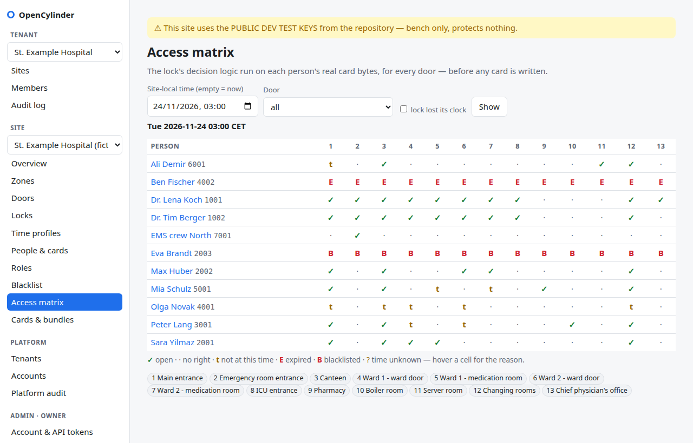
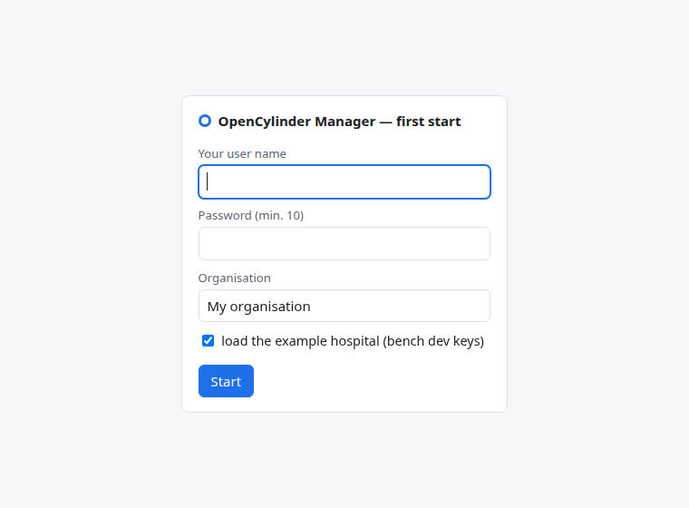
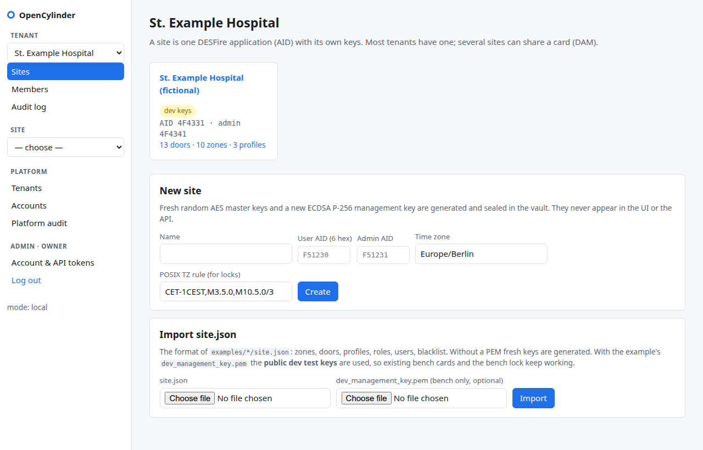
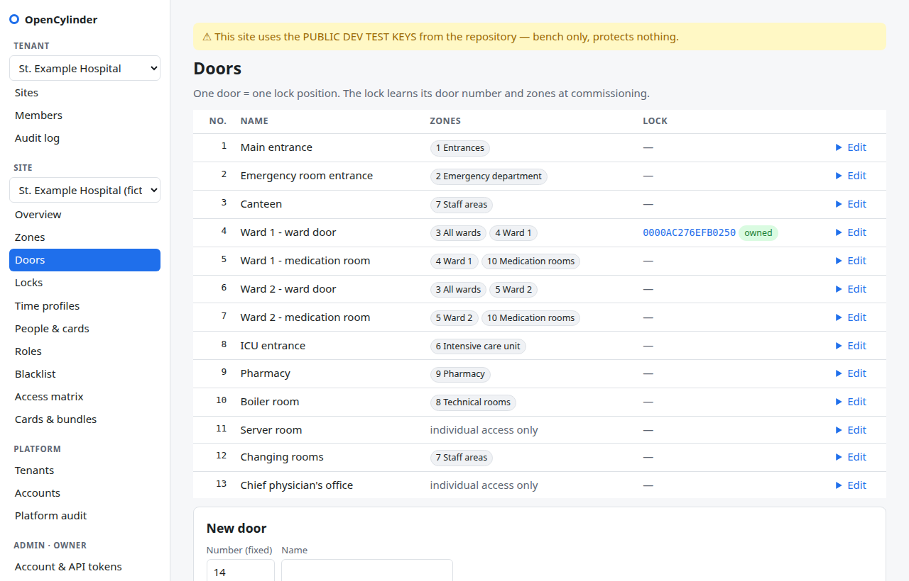
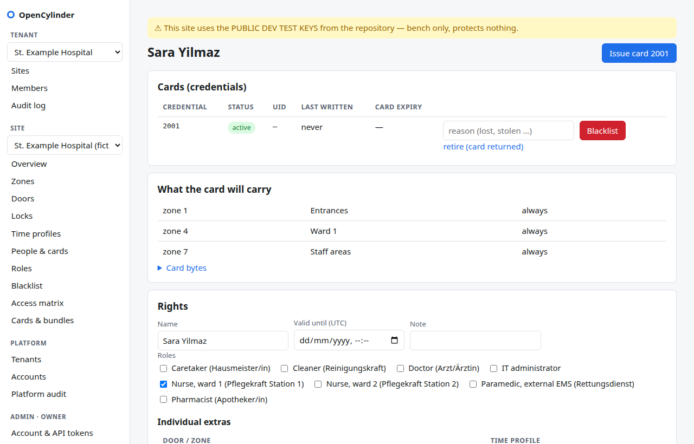
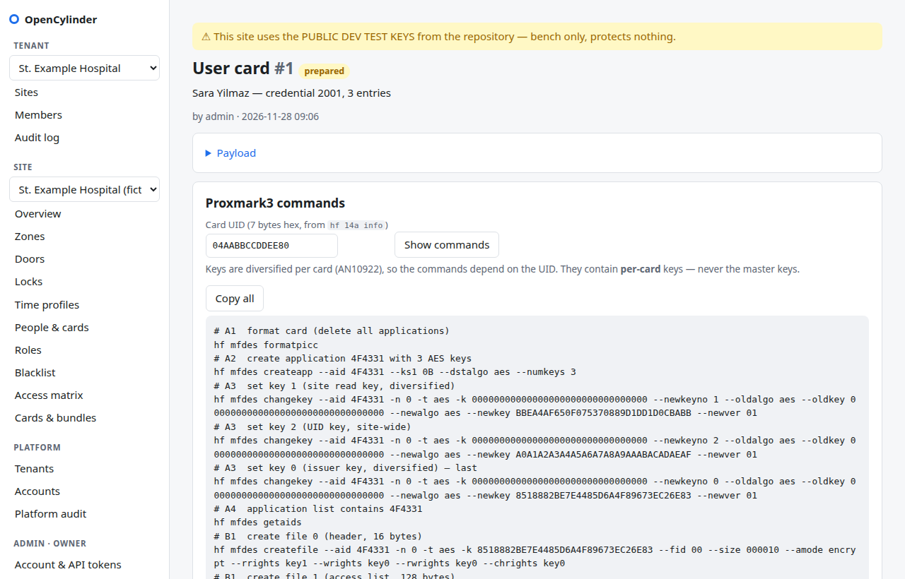
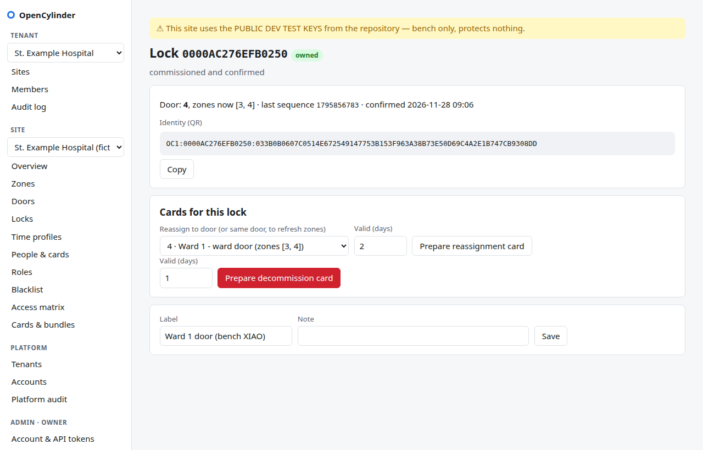
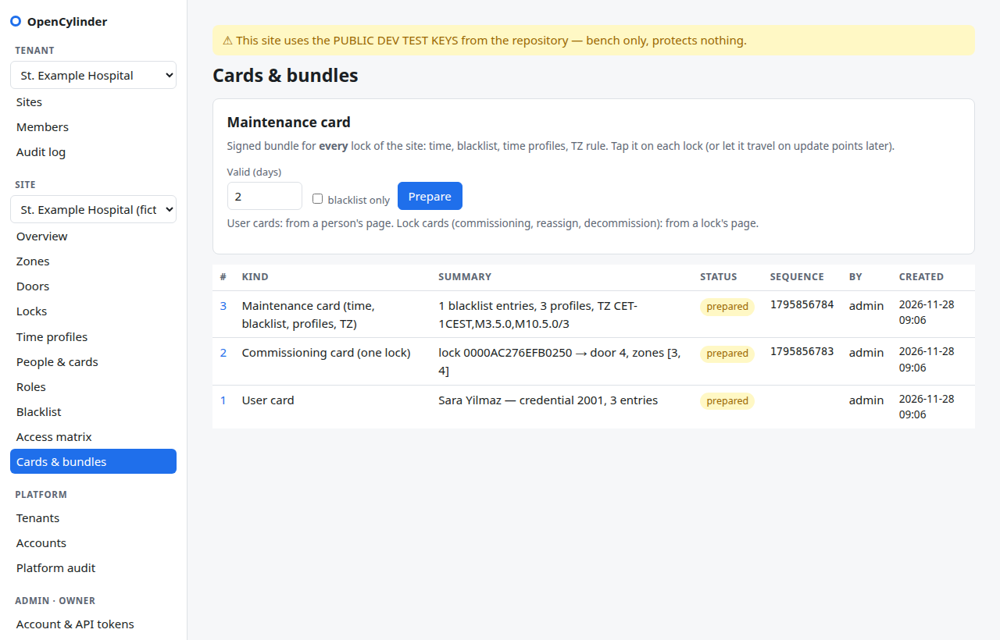
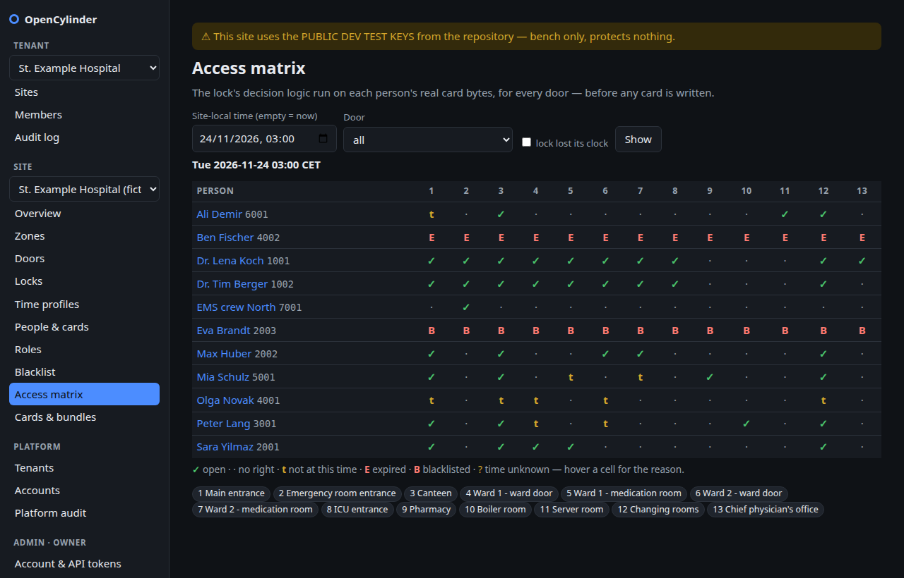

# OpenCylinder Manager

Manage your OpenCylinder site in the browser: doors, zones, time profiles, people, their cards, your locks and the signed admin cards.



## Start

```bash
python3 manager/app.py            # then open http://127.0.0.1:8243
```

That's all you need.

- **First start:** the browser asks for a user name and password. Leave "load the example hospital" ticked to get a complete example site to play with.
- **Forgot your password?** `python3 manager/app.py --reset-password USER` (without USER it lists the users).
- **Start over:** stop it (Ctrl+C) and delete `manager/data/`.
- **Other port, or reachable from your network:** add `--port 8250` and/or `--host 0.0.0.0`.
- **Missing packages?** The script tells you the one line to run. It uses `manager/.venv` automatically.

<p></p>

## What you do with it

1. **Describe the building.** Add doors and zones (a zone groups doors, e.g. "Ward 1"), plus time profiles such as "Day shift 06–20".
2. **Add people.** Give each person roles (templates like "Nurse, ward 1") and individual extras. The **access matrix** shows at once who opens which door at any time, using the lock's own decision logic.
3. **Issue cards.** The manager prepares the card and shows the Proxmark3 commands for that card's UID. With a Proxmark3 attached (`OCM_PM3_PATH=~/proxmark3/pm3`), it writes the card itself.
4. **Commission locks.** Register a lock by its QR text and prepare a commissioning card for its door. The card is encrypted to that one lock. Tap it, then click "confirm".
5. **Keep locks up to date.** A lost card goes on the blacklist. Profile or time-zone changes travel with a signed **maintenance card** that you tap on the locks.

## Tour

| | |
|---|---|
|  **Sites.** One per DESFire application, each with its own keys. Create one, or import a `site.json`. |  **Doors and zones.** Includes which lock sits where. |
|  **A person.** Their cards, what the card will carry, roles and extra rights. |  **Card job.** Proxmark3 commands for this card's UID (per-card keys only). |
|  **A lock.** Identity, state, and cards for commissioning, reassignment and decommissioning. |  **Cards and bundles.** Every prepared card, with signed sequence numbers. |

Dark mode follows your system setting:

<p></p>

## Good to know

- **Offline.** One Python process with SQLite. It never contacts the internet: no CDN, no cloud, no telemetry.
- **Several organisations.** One installation can serve several tenants, each strictly isolated. Each member has a role: owner, admin, operator or auditor.
- **Your keys stay sealed.** Site keys are encrypted at rest and never shown. A copy of the database alone reveals nothing.
- **Same bytes as the reference scripts.** Cards and bundles are byte-identical to `examples/hospital/*.py`, and tests check this.
- **Status: v0.1.** Tested with the example sites and in automated tests. The Proxmark write path has not been tried on hardware yet, and it is not for a real door yet.

## Scripted setup (`ocm` CLI)

```bash
cd manager
python3 -m venv .venv && .venv/bin/pip install -e '.[dev]'
export OCM_DATA_DIR=./data                       # database + key files (git-ignored)

.venv/bin/ocm init --admin alice                 # first platform admin (asks for a password)
.venv/bin/ocm create-tenant hospital "St. Example Hospital" --owner alice
# bench: import the example site with its PUBLIC dev test keys, so existing dev
# cards and the bench lock keep working
.venv/bin/ocm import-site hospital ../examples/hospital/site.json \
    --dev-pem ../examples/hospital/dev_management_key.pem
.venv/bin/ocm serve                              # http://127.0.0.1:8243
```

If you import without `--dev-pem`, the manager generates fresh random keys. Do that for a real site.

To let the manager write cards itself, attach a Proxmark3 and set `OCM_PM3_PATH=~/proxmark3/pm3` (optional: `OCM_PM3_PORT=/dev/ttyACM1`). Card jobs then get a "write" button. Without it, the manager shows the Proxmark commands to copy.

## Architecture

```
src/ocmanager/
  protocol/        pure wire formats, no web: card, bundle, an10922, commissioning, decision, encoder
  core/            config, db (SQLAlchemy 2), vault, security (auth, CSRF, tokens), tenancy, audit,
                   module registry, web helpers
  modules/         one package per feature:
    auth           login, account, personal API tokens
    platform       tenants, operator accounts, tenant members
    sites          sites, sealed keys, zones, doors, time profiles, site.json import/export
    people         roles, cardholders, credentials, blacklist
    locks          lock registry (QR identity), states
    cards          card jobs: user, maintenance, blacklist, commissioning, reassign, decommission
                   + Proxmark3 plans and the local runner
    access         access matrix (the lock's decision logic on real card bytes)
    audit          append-only audit log
  web/             Jinja2 templates + static (own CSS, vendored htmx 2.0.4, tiny app.js)
```

**Every module has the same layers:**
- `models.py`
- `schemas.py` (Pydantic)
- `service.py` (business logic)
- `api.py` (JSON under `/api/v1`)
- `ui.py` (HTML)
- `module.py` (registration)

**How modules connect:**
- The JSON API and the HTML UI call the same service functions.
- Modules talk to each other only through service functions and hooks (`sites.IMPORT_HOOKS`, `EXPORT_HOOKS`, `USAGE_HOOKS`).
- `OCM_MODULES` picks which modules to load.
- Third-party packages add modules through the entry-point group `ocmanager.modules` (see `core/modules.py`).

**UI:** server-rendered HTML with htmx (`hx-boost`, live search, live matrix). There is no Node build. Every page also works without JavaScript.

**API:** the OpenAPI schema is at `/api/openapi.json`. Swagger UI is switched off because it loads from a CDN. Authenticate with a session cookie plus `X-CSRF-Token`, or with `Authorization: Bearer ocm_…` (create the token under *Account*).

## Multi-tenancy and roles

| Concept | What it is |
|---|---|
| Tenant | An organisation. It owns sites, and each site has its own keys, people and locks. |
| Operator | A login account. It is a member of tenants, with one role per tenant. |
| Platform admin | Creates tenants and accounts. Sees a tenant's data **only as a member** of it. |

| Role | May |
|---|---|
| owner | Everything, including members and deleting sites |
| admin | Structure, locks, signed bundles, all cards, audit |
| operator | People, credentials and user cards |
| auditor | Read everything, plus the audit log |

**How isolation works:**
- Every tenant route goes through `core/tenancy.py:tenant_ctx`, which checks the caller's membership.
- Rows are loaded only through `ctx.site()` / `ctx.get()`, which prove the row belongs to the tenant and the site.
- A foreign tenant gets 404, not 403, so it cannot even learn that a tenant exists.
- `tests/test_web.py::test_tenant_isolation_and_roles` checks this.

## Security

**Site keys** (5 AES masters plus the ECDSA management key):
- They are sealed with AES-256-GCM under a key-encryption key. The KEK is `OCM_MASTER_KEY` or `data/master.key` (mode 0600).
- Each sealed blob is bound to its site and purpose through the AAD, so blobs can't be swapped between sites.
- A database dump alone reveals no key.
- Keys never appear in the UI or the API. The only exception is per-card diversified keys inside Proxmark plans, which only `cards.issue` can see.
- For production, replace the KEK file with an HSM, TPM or OS keyring.

**Login and sessions:**
- Passwords: Argon2id, at least 10 characters. Failed logins are throttled per user and IP. Every login and failure is logged.
- Sessions: a signed cookie, `SameSite=Strict` and HttpOnly. In server mode the cookie is Secure and HSTS is on.
- Changing a password logs the user out of all other sessions.
- CSRF tokens are required on all form posts and on cookie-authenticated API writes.

**Headers:**
- Strict CSP: no inline scripts or styles, nothing from outside the app.
- `X-Frame-Options: DENY`, `Referrer-Policy: no-referrer`, `Cache-Control: no-store`.

**Domain rules:**
- Zone, door and profile numbers and AIDs are fixed once created, because cards and locks depend on them.
- Zones, doors and profiles that are still in use cannot be deleted.
- Bundle sequence numbers increase monotonically per site.
- Admin cards expire after at most 30 days.
- A blacklist entry stays only as long as the blocked card could still open something.

## Server mode

```bash
OCM_MODE=server OCM_DATA_DIR=/var/lib/ocmanager OCM_DATABASE_URL=postgresql+psycopg://… \
  ocm serve --host 127.0.0.1 --port 8243           # behind nginx/caddy with TLS
```

- Postgres needs `pip install -e '.[postgres]'`. SQLite works for small installations.
- On a server there is no Proxmark attached. Card jobs are prepared in the browser, and an encoder PC fetches the plan through the API: `POST …/cards/{job}/plan {uid}`, then `POST …/cards/{job}/written`.
- A small encoder agent for that last step is a planned next step.

## Settings (environment, prefix `OCM_`)

| Variable | Default | Meaning |
|---|---|---|
| `MODE` | `local` | `local` binds to 127.0.0.1; `server` sets Secure cookies and HSTS |
| `DATA_DIR` | `./data` | Database, `master.key`, `session.key` |
| `DATABASE_URL` | SQLite in `DATA_DIR` | Any SQLAlchemy URL |
| `MASTER_KEY` | file | 32-byte hex KEK (instead of `master.key`) |
| `MODULES` | `*` | Comma list of modules to load |
| `PM3_PATH`, `PM3_PORT` | — | Local Proxmark3 encoder |
| `ALLOW_DEV_KEYS` | `true` | Allow importing the public bench test keys (set `false` in production) |

## Tests

```bash
.venv/bin/python -m pytest -q
```

## Next steps

- Alembic migrations.
- Encoder agent for server mode.
- Identify-card read-out (QR without engraving).
- DAM, for several sites on one card.
- Lock event-log import, once it can be read from admin cards.
- Time-profile and TZ changes per lock.
- OIDC login for larger organisations.
- Backup/restore command (database plus KEK, stored separately).
